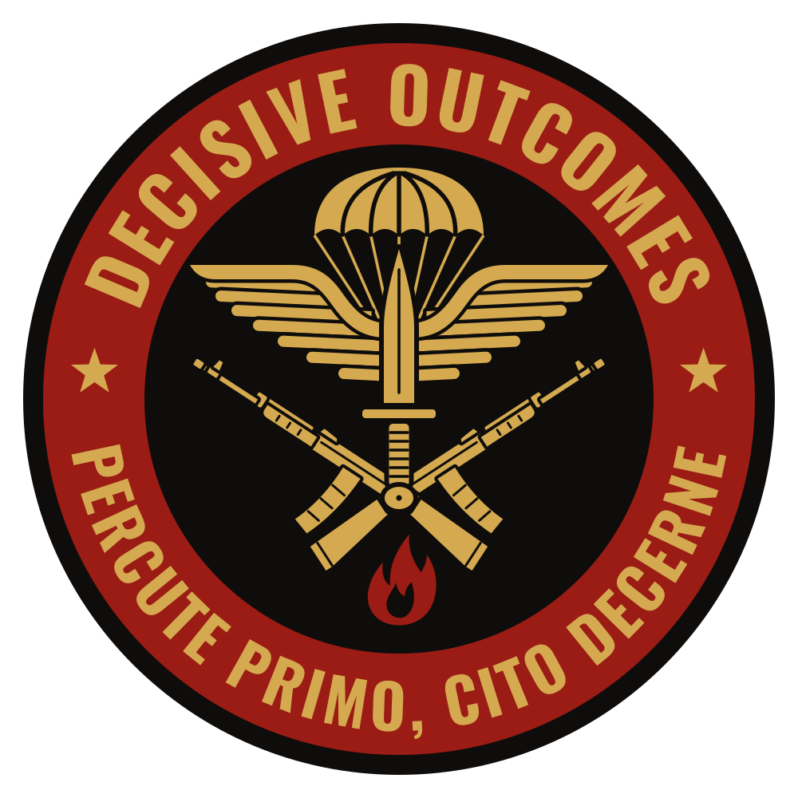

  

# Decisive Outcomes

Alles rond het airsoftteam Decisive Outcomes: het verhaal, de huisstijl en de website voor [decisiveoutcomes.nl](https://decisiveoutcomes.nl).

Decisive Outcomes is een verzonnen private military company. In 1979 bleven vier Rhodesische verkenners achter in Mozambique, met een kist die ze nooit hebben afgeleverd. Uit die vier groeide een wereldwijd concern dat nog altijd stand-by staat. Het verhaal is fictie en satire; de personages zijn gebaseerd op de echte teamleden.

## Inhoud

| Map | Wat erin staat |
|---|---|
| [`verhaal/`](verhaal/) | De backstory in [`backstory.md`](verhaal/backstory.md): Deel 1 vertelt hoe het begon, Deel 2 beschrijft het concern van nu. |
| [`logo/`](logo/) | Het logo als SVG (bron) en als PNG van 2000 px. |
| [`docs/`](docs/) | Beslissingen, openstaande punten en de toestemming van teamleden. |
| [`website/`](website/) | De opzet van de website: de [sitemap](website/sitemap.md), de [beeldtaal en Gemini-prompts](website/beeldtaal.md) en later de site zelf. |

## Huisstijl

- **Kleuren:** goud `#D4A94F`, rood `#9B1C15`, zwart `#0F0D0B`.
- **Lettertypes:** Oswald voor koppen, Source Sans 3 voor lopende tekst.
- **Toon:** zakelijk en droog. De site ziet eruit als die van een echt beveiligingsbedrijf; de humor zit in de details.

## De website

De site wordt met de hand gebouwd in HTML, CSS en PHP:

- snel en responsive;
- toegankelijk volgens WCAG 2.2;
- met een strikte Content Security Policy;
- zonder cookies, trackers of externe diensten.

Alle eisen staan in [`website/CLAUDE.md`](website/CLAUDE.md).

## Werkafspraken

- Projectafspraken, de canon van het verhaal en de stijlregels staan in [`CLAUDE.md`](CLAUDE.md).
- Alles is in het Nederlands.
- Wijzigingen gaan direct op `main`, met korte Nederlandse commitberichten.
- De kist blijft dicht.

## Licentie

De code van de website valt onder MIT; teksten, logo en beelden zijn auteursrechtelijk beschermd. Zie [LICENSE.md](LICENSE.md). Dit is nog een voorstel.
